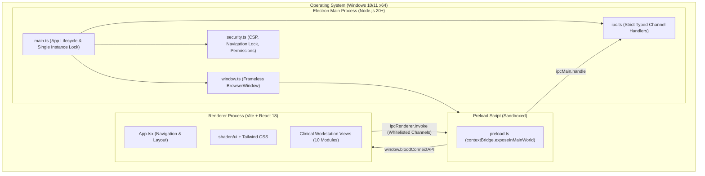

# BloodConnect Architecture — Phase 1: Desktop Foundation

## Overview

BloodConnect is a commercial Windows desktop application designed for clinical blood bank operations. Phase 1 establishes the rock-solid desktop foundation, hardened security perimeter, typed IPC bridge, and standard workstation user interface.

## Monorepo Structure

```text
blood-connect/
├── apps/
│   ├── desktop/               # Electron + React + Vite + TypeScript desktop client
│   └── api/                   # NestJS Central Backend (Scheduled for Phase 2)
├── packages/
│   ├── shared/                # Shared contracts, clinical types, IPC definitions
│   └── config/                # Shared TypeScript compiler configurations
├── docs/                      # Architectural, security, and developer documentation
├── scripts/                   # Workspace automation utilities
├── package.json               # Root npm workspaces configuration
├── package-lock.json
├── .gitignore
├── .env.example
└── README.md
```

## Desktop Process Model

The desktop application enforces a strict two-process model:



## Phase 1 Architectural Constraints & Compliance

In strict compliance with the Phase 1 master brief:

| Constraint | Status | Implementation Verification |
| :--- | :--- | :--- |
| **No SQLite** | Enforced | Zero local database files or drivers installed. |
| **No local donor database** | Enforced | No mock or cached donor tables exist in client storage. |
| **No offline functionality** | Enforced | Offline synchronizer engines are omitted. |
| **No synchronization engine** | Enforced | Sync pipelines will be driven centrally in Phase 2. |
| **No SMS integration** | Enforced | Telephony and SMS gateways deferred to central backend. |
| **No fake authentication** | Enforced | No mocked user stores or simulated sessions exist. |
| **No fake donor management** | Enforced | Views display authentic empty states awaiting API link. |
| **No secrets in frontend** | Enforced | Zero tokens or private keys packaged in bundle. |

